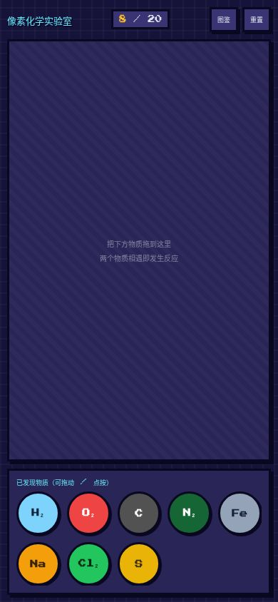

# 像素化学实验室

一个「拖拽合成」的化学小游戏。把两个物质拖到一起，如果它们能发生真实化学反应，就会生成新的物质并给出配平的化学方程式。

玩法参考经典网页游戏 *Little Alchemy*（合成万物），但把「水 + 火 = 蒸汽」换成了严格遵循中学化学的化学反应式。



## 特性

- **真实化学**：所有配方都是真实存在的化学反应，合成成功时显示配平方程式
- **拖拽操作**：拖动图标到工作台，两个物质相遇即判定；同时支持点按（触摸设备等价路径）
- **失败反馈**：不能反应时两个图标振动后弹回，不弹任何提示
- **图鉴收集**：已发现物质按 单质 / 氧化物 / 酸 / 碱 / 盐 / 氢化物 分类展示
- **自动存档**：进度存在浏览器 localStorage，关掉页面再打开不丢
- **零依赖**：单个 HTML 文件，无框架、无构建、无后端

## 快速开始

直接用浏览器打开 `index.html` 即可，不需要任何安装步骤。

或者起一个本地服务器（可选）：

```bash
python3 -m http.server 8000
# 然后访问 http://localhost:8000
```

## 内容规模

- 物质：21 种
- 配方：17 条
- 开局物质：H₂、O₂、C、N₂、Fe、Na、Cl₂、S（8 种单质）

## 反应配方

| 反应物 | 生成物 | 方程式 |
|---|---|---|
| H₂ + O₂ | H₂O | 2H₂ + O₂ → 2H₂O |
| C + O₂ | CO₂ | C + O₂ → CO₂ |
| Na + Cl₂ | NaCl | 2Na + Cl₂ → 2NaCl |
| H₂ + Cl₂ | HCl | H₂ + Cl₂ → 2HCl |
| Fe + O₂ | Fe₂O₃ | 4Fe + 3O₂ → 2Fe₂O₃ |
| S + O₂ | SO₂ | S + O₂ → SO₂ |
| H₂O + CO₂ | H₂CO₃ | H₂O + CO₂ → H₂CO₃ |
| Na + H₂O | NaOH | 2Na + 2H₂O → 2NaOH + H₂ |
| Fe + Cl₂ | FeCl₃ | 2Fe + 3Cl₂ → 2FeCl₃ |
| NaOH + CO₂ | Na₂CO₃ | 2NaOH + CO₂ → Na₂CO₃ + H₂O |
| N₂ + H₂ | NH₃ | N₂ + 3H₂ → 2NH₃ |
| NH₃ + HCl | NH₄Cl | NH₃ + HCl → NH₄Cl |
| NH₃ + H₂O | NH₃·H₂O | NH₃ + H₂O ⇌ NH₃·H₂O |
| NaOH + HCl | NaCl | NaOH + HCl → NaCl + H₂O |
| NaOH + H₂CO₃ | Na₂CO₃ | 2NaOH + H₂CO₃ → Na₂CO₃ + 2H₂O |
| HCl + Na₂CO₃ | NaCl | 2HCl + Na₂CO₃ → 2NaCl + H₂O + CO₂ |
| Fe₂O₃ + HCl | FeCl₃ | Fe₂O₃ + 6HCl → 2FeCl₃ + 3H₂O |

## 项目结构

```
.
├── index.html      # 游戏本体，单文件自包含
├── docs/
│   └── preview.png # README 预览图
├── LICENSE
└── README.md
```

## 部署到 GitHub Pages

1. 把仓库推到 GitHub
2. 进入仓库 **Settings → Pages**
3. Source 选 **Deploy from a branch**，分支选 `main`，目录选 `/ (root)`
4. 等一两分钟，访问 `https://<你的用户名>.github.io/<仓库名>/`

因为入口文件就叫 `index.html`，不需要任何额外配置。

## 自定义

想加物质或加配方，改 `index.html` 里的两个数组即可：

```js
// 物质：id 唯一，cat 决定图鉴分类
const SUBSTANCES = [
  {id:"h2o", f:"H₂O", name:"水", color:"#0ea5e9", text:"#fff", cat:"氧化物"},
  // ...
];

// 配方：a、b 为反应物 id，r 为生成物 id，eq 为方程式（纯展示用）
const RECIPES = [
  {a:"h2", b:"o2", r:"h2o", eq:"2H₂ + O₂ → 2H₂O"},
  // ...
];
```

注意：配方判定不区分反应物顺序，`a` 和 `b` 可以互换。

## 已知限制

- 不考虑化学计量比：一个 H₂ 加一个 O₂ 就能合成水，配平只在方程式里体现
- 反应条件从简：加热、催化剂、浓度等条件未实现
- 部分反应会生成多种产物，游戏里按主要产物处理
- 无音效

## License

MIT
